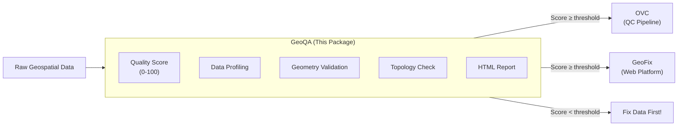
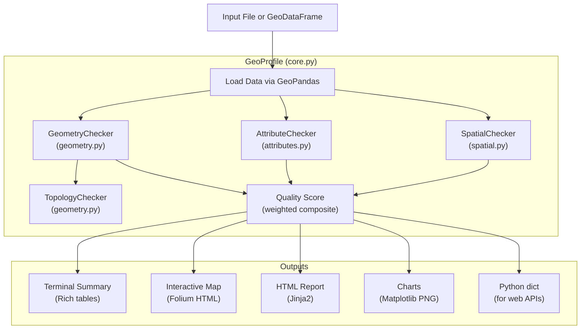

# GeoQA — Product Requirements Document

**Full Name:** Geospatial Quality Assessment
**Version:** 0.2.0
**Author:** Ammar Yasser Abdalazim
**License:** MIT
**Python:** 3.9+
**Repository:** [github.com/AmmarYasser455/geoqa](https://github.com/AmmarYasser455/geoqa)
**PyPI:** [pypi.org/project/geoqa](https://pypi.org/project/geoqa/)

---

## 1. Overview

GeoQA is a Python package for **automated quality assessment and interactive profiling** of geospatial vector data. It is designed as the geospatial equivalent of [ydata-profiling](https://github.com/ydataai/ydata-profiling) (formerly pandas-profiling) — profile any vector dataset with a single line of code.

GeoQA answers the question: **"Is this geodata ready for analysis or QC?"** by providing:
- A composite quality score (0–100)
- Geometry validation (invalid, empty, duplicate, mixed-type detection)
- Attribute profiling (completeness, statistics, distributions)
- Topology analysis (gaps, overlaps, slivers, bad rings)
- Interactive Folium maps with quality-issue highlighting
- Self-contained HTML quality reports with embedded charts

### 1.1 Ecosystem Position

GeoQA serves as the **data-readiness gate** in a geospatial quality control pipeline:



---

## 2. Actual Use

### 2.1 Who Uses GeoQA

- **GIS analysts** who need quick data quality assessment before analysis
- **Data engineers** building geospatial ETL pipelines with quality gates
- **QC teams** validating data deliverables from survey contractors
- **Developers** integrating data quality checks into web applications (like GeoFix)
- **Students** learning about geospatial data quality concepts

### 2.2 Real-World Workflow

**Scenario 1 — Quick Desktop Assessment:**
```python
import geoqa

# One-liner: profile a shapefile
profile = geoqa.profile("buildings.shp")
profile.summary()           # Print summary to terminal
profile.quality_checks()    # Tabular quality check results
profile.show_map()          # Open interactive map in browser
profile.to_html("report.html")  # Generate full HTML report
```

**Scenario 2 — QC Pipeline Gate (with OVC):**
```bash
# Step 1: Run GeoQA pre-check
geoqa check buildings.shp
# Output: Quality Score: 87/100 — PASS

# Step 2: If passed, run OVC
python scripts/run_qc.py --buildings buildings.shp --out outputs
```

**Scenario 3 — Web Application Integration (GeoFix):**
```python
# Inside GeoFix's geoqa_service.py
from geoqa.core import profile
from geoqa.geometry import TopologyChecker

gp = profile(file_path)
summary = gp.summary(print_output=False)
quality_checks = gp.quality_checks().to_dict(orient="records")
score = gp.quality_score

topo_checker = TopologyChecker(gp.gdf)
topology = topo_checker.check_all()
```

### 2.3 CLI Usage

```bash
geoqa profile data.shp                       # Full profile summary
geoqa report data.shp --output report.html    # Generate HTML report
geoqa check data.geojson                      # Run quality checks only
geoqa show data.gpkg --output map.html        # Generate interactive map
```

---

## 3. Architecture

### 3.1 Module Structure

```
geoqa/                        # Root package
├── __init__.py               # Public API (profile, GeoProfile, TopologyChecker)
│
├── core.py                   # GeoProfile class — main entry point (18.6KB)
│                             # - profile() function
│                             # - summary(), quality_checks(), quality_score
│                             # - show_map(), to_html()
│                             # - attribute_stats(), geometry_stats()
│
├── geometry.py               # Geometry validation & quality checks (15.9KB)
│                             # - GeometryChecker: validity, empty, duplicate
│                             # - TopologyChecker: gaps, overlaps, slivers, bad rings
│
├── attributes.py             # Attribute profiling & statistics (6.6KB)
│                             # - Data types, null analysis, unique values
│                             # - Descriptive statistics per column
│
├── spatial.py                # CRS & spatial analysis (7.2KB)
│                             # - CRS detection and info
│                             # - Extent/bounds computation
│                             # - Area/length statistics
│                             # - Centroid computation
│
├── visualization.py          # Interactive map generation (9.8KB)
│                             # - MapVisualizer: Folium map creation
│                             # - Quality highlighting (invalid=red, valid=blue)
│                             # - Auto-reprojection to WGS84
│                             # - Interactive tooltips and layer controls
│
├── report.py                 # HTML report generation (22.2KB)
│                             # - Jinja2-based self-contained HTML reports
│                             # - Quality score badges
│                             # - Dataset overview cards
│                             # - Quality check tables with pass/fail/warn
│
├── charts.py                 # Matplotlib chart generation (18.3KB)
│                             # - generate_all_charts(): full chart suite
│                             # - quality_gauge(): circular quality score gauge
│                             # - Distribution plots, bar charts, pie charts
│
├── cli.py                    # Click-based CLI interface (4.2KB)
│                             # - geoqa profile <file>
│                             # - geoqa report <file>
│                             # - geoqa check <file>
│                             # - geoqa show <file>
│
└── utils.py                  # Utility functions (3.1KB)
                              # - make_serializable(): convert numpy types to JSON
                              # - File format detection
```

### 3.2 Data Flow



---

## 4. Core Components (Detailed)

### 4.1 GeoProfile (`core.py`)

The main class. Created via `geoqa.profile(source)` where source can be a file path string or a GeoDataFrame.

**Key Properties:**

| Property | Type | Description |
|---|---|---|
| `gdf` | `GeoDataFrame` | The loaded geodataframe |
| `name` | `str` | Dataset name (from filename or user-provided) |
| `quality_score` | `int` | Composite quality score (0-100) |
| `_geometry_results` | `dict` | Raw geometry check results |
| `_attribute_results` | `dict` | Raw attribute profiling results |
| `_spatial_results` | `dict` | Raw spatial analysis results |

**Key Methods:**

| Method | Returns | Description |
|---|---|---|
| `summary(print_output=True)` | `dict` | Print/return dataset summary (feature count, CRS, extent, score) |
| `quality_checks()` | `DataFrame` | Tabular quality check results with pass/fail/warn |
| `attribute_stats()` | `dict` | Per-column statistics (type, nulls, unique, min/max/mean) |
| `geometry_stats()` | `dict` | Geometry validation results (valid/invalid/empty/duplicate counts + indices) |
| `show_map()` | `Map` | Open interactive Folium map in browser |
| `to_html(path)` | `None` | Generate self-contained HTML quality report |

### 4.2 GeometryChecker (`geometry.py`)

Validates geometry quality at the individual feature level.

**Checks Performed:**

| Check | Method | Algorithm |
|---|---|---|
| Geometry Validity | `check_validity()` | `shapely.is_valid` on each geometry |
| Empty Geometries | `check_empty()` | `geometry.is_empty` check |
| Duplicate Geometries | `check_duplicates()` | WKB (Well-Known Binary) hash comparison |
| Mixed Geometry Types | `check_mixed_types()` | Count distinct geometry types in layer |
| Null Geometries | `check_null()` | `geometry is None` check |

**Returns:** Dictionary with counts, indices of problematic features, and validity reasons.

### 4.3 TopologyChecker (`geometry.py`)

Validates geometric relationships between features in a dataset.

**Checks Performed:**

| Check | Method | Description |
|---|---|---|
| Overlaps | `check_overlaps()` | Finds features that overlap each other |
| Gaps | `check_gaps()` | Finds gaps between adjacent features |
| Slivers | `check_slivers()` | Finds thin polygon slivers (area/perimeter ratio below threshold) |
| Bad Rings | `check_bad_rings()` | Finds polygon rings that are not properly closed or are self-intersecting |

**Usage:**
```python
from geoqa.geometry import TopologyChecker

checker = TopologyChecker(gdf)
results = checker.check_all()
# Returns: {"overlaps": [...], "gaps": [...], "slivers": [...], "bad_rings": [...]}
```

### 4.4 Attribute Profiler (`attributes.py`)

Profiles all non-geometry columns in the dataset.

**Per-Column Statistics:**

| Statistic | Applicable Types | Description |
|---|---|---|
| `dtype` | All | Python/pandas data type |
| `null_count` | All | Number of null/NaN values |
| `null_percent` | All | Percentage of null values |
| `unique_count` | All | Number of distinct values |
| `min` / `max` | Numeric | Range |
| `mean` / `std` | Numeric | Central tendency and spread |
| `top_values` | Categorical | Most frequent values with counts |

### 4.5 Spatial Analyzer (`spatial.py`)

Provides CRS and spatial extent information.

**Analysis Areas:**

| Analysis | Description |
|---|---|
| CRS Info | EPSG code, proj4 string, WKT, units, is_geographic flag |
| Bounds | `[minx, miny, maxx, maxy]` total bounds |
| Area Statistics | Min/max/mean/std area (for polygon layers) |
| Length Statistics | Min/max/mean/std length (for line layers) |
| Centroid | Dataset centroid coordinates |

### 4.6 MapVisualizer (`visualization.py`)

Creates interactive Folium maps with quality-issue highlighting.

**Features:**
- Auto-reprojection to WGS84 for web display
- Color coding: invalid geometries in red, valid in blue
- Interactive tooltips with feature attributes
- Multiple basemap options (OpenStreetMap, Satellite, etc.)
- Layer control to toggle issue layers
- Auto-zoom to data extent

### 4.7 Report Generator (`report.py`)

Generates self-contained HTML quality reports using Jinja2 templates.

**Report Sections:**
- Quality score badge (large, color-coded: green/yellow/red)
- Dataset overview card (name, CRS, feature count, geometry type)
- Quality check results table (pass ✅ / warn ⚠️ / fail ❌)
- Spatial extent information
- Attribute completeness bars
- Numeric column statistics
- Geometry type distribution chart
- Embedded interactive map

### 4.8 Chart Generator (`charts.py`)

Generates Matplotlib charts embedded as base64 PNGs in HTML reports.

**Chart Types:**
- `quality_gauge()` — circular gauge showing quality score
- Geometry type distribution (pie chart)
- Attribute completeness (horizontal bar chart)
- Numeric column distributions (histograms)
- CRS information card

---

## 5. Quality Score

GeoQA computes a weighted composite quality score from 0 to 100:

| Component | Weight | Scoring Logic |
|---|---|---|
| **Geometry Validity** | 40% | `(valid_count / total_count) × 100` |
| **Attribute Completeness** | 30% | `(non_null_count / total_cells) × 100` |
| **CRS Defined** | 15% | `100` if CRS is set, `0` otherwise |
| **No Empty Geometries** | 15% | `(non_empty_count / total_count) × 100` |

**Score Interpretation:**

| Range | Rating | Color | Action |
|---|---|---|---|
| 90-100 | Excellent | 🟢 Green | Data is ready for use |
| 70-89 | Good | 🟡 Yellow | Minor issues, proceed with caution |
| 50-69 | Fair | 🟠 Orange | Significant issues need attention |
| 0-49 | Poor | 🔴 Red | Data needs major repair before use |

---

## 6. CLI Reference

GeoQA provides a Click-based CLI accessible via `geoqa` command (installed via `pip install geoqa`):

| Command | Arguments | Description |
|---|---|---|
| `geoqa profile <file>` | `<file>` | Print full dataset profile to terminal |
| `geoqa report <file>` | `--output <path>` | Generate HTML quality report |
| `geoqa check <file>` | | Run quality checks only, print results |
| `geoqa show <file>` | `--output <path>` | Generate and open interactive map |

---

## 7. Dependencies

| Package | Version | Purpose |
|---|---|---|
| `geopandas` | ≥0.14.0, <1.0 | Core geospatial data processing |
| `shapely` | ≥2.0.0, <3.0 | Geometry operations and validation |
| `folium` | ≥0.15.0, <1.0 | Interactive web map generation |
| `matplotlib` | ≥3.7.0, <4.0 | Chart generation for reports |
| `pandas` | ≥2.0.0, <3.0 | Tabular data processing |
| `numpy` | ≥1.24.0, <2.0 | Numerical computations |
| `jinja2` | ≥3.1.0, <4.0 | HTML report templating |
| `click` | ≥8.1.0, <9.0 | CLI framework |
| `rich` | ≥13.0.0, <14.0 | Terminal formatting and tables |
| `branca` | ≥0.7.0, <1.0 | Folium dependency for map coloring |

**Dev dependencies:** `pytest`, `pytest-cov`, `black`, `isort`, `ruff`
**Docs dependencies:** `mkdocs`, `mkdocs-material`, `mkdocstrings[python]`

---

## 8. Supported Formats

All vector formats readable by GeoPandas/Fiona via GDAL/OGR drivers:

| Format | Extension | Input | Notes |
|---|---|---|---|
| Shapefile | `.shp` | ✅ | Requires companion .dbf, .shx, .prj |
| GeoJSON | `.geojson`, `.json` | ✅ | |
| GeoPackage | `.gpkg` | ✅ | |
| KML | `.kml` | ✅ | |
| GML | `.gml` | ✅ | |
| CSV with Geometry | `.csv` | ✅ | Requires WKT geometry column |
| File Geodatabase | `.gdb` | ✅ | Requires GDAL with FileGDB driver |
| GeoDataFrame | (in-memory) | ✅ | Pass directly to `geoqa.profile()` |

---

## 9. Integration with GeoFix

GeoQA is installed as a Git dependency in GeoFix:
```
# In GeoFix requirements.txt
git+https://github.com/AmmarYasser455/geoqa.git
```

GeoFix's `GeoQAService` wraps GeoQA's profiling and topology checking:

```python
# GeoFix backend/services/geoqa_service.py
from geoqa.core import profile
from geoqa.geometry import TopologyChecker

class GeoQAService:
    @staticmethod
    def analyze_file(file_path):
        gp = profile(file_path)
        summary = gp.summary(print_output=False)
        quality_checks = gp.quality_checks().to_dict(orient="records")
        geometry_stats = gp._geometry_results.copy()
        
        topo_checker = TopologyChecker(gp.gdf)
        topology = topo_checker.check_all()
        
        return {
            "summary": summary,
            "quality_checks": quality_checks,
            "geometry_stats": geometry_stats,
            "topology": topology,
            "score": gp.quality_score,
            "bounds": list(gp.gdf.total_bounds),
        }
```

---

## 10. Integration with OVC

GeoQA serves as OVC's pre-check data quality gate:

```python
# OVC's precheck module uses GeoQA to validate data
# before running the full QC pipeline

# When user runs: python scripts/run_qc.py --precheck
# OVC calls GeoQA to:
# 1. Profile each input dataset
# 2. Compute quality scores
# 3. Generate HTML quality reports
# 4. Block pipeline if score < threshold
```

---

## 11. Testing

```bash
pytest                              # Run full test suite
pytest --cov=geoqa --cov-report=html  # Coverage report
pytest -v --tb=short                # Verbose with short tracebacks (default config)
```

---

## 12. Documentation

GeoQA uses MkDocs with Material theme for documentation:

```bash
pip install geoqa[docs]
mkdocs serve    # Local preview at http://localhost:8000
mkdocs build    # Build static site to site/
```

---

## 13. Changelog Highlights

| Version | Key Changes |
|---|---|
| **v0.2.0** | Added TopologyChecker, improved chart generation, GeoFix integration |
| **v0.1.0** | Initial release — profiling, quality scoring, maps, reports, CLI |

---

## 14. Acknowledgments

GeoQA is inspired by:
- [ydata-profiling](https://github.com/ydataai/ydata-profiling) — pandas profiling for tabular data
- [leafmap](https://github.com/opengeos/leafmap) — interactive geospatial mapping by Dr. Qiusheng Wu
- [geemap](https://github.com/gee-community/geemap) — Google Earth Engine mapping
- The [opengeos](https://github.com/opengeos) community and open-source GIS philosophy
