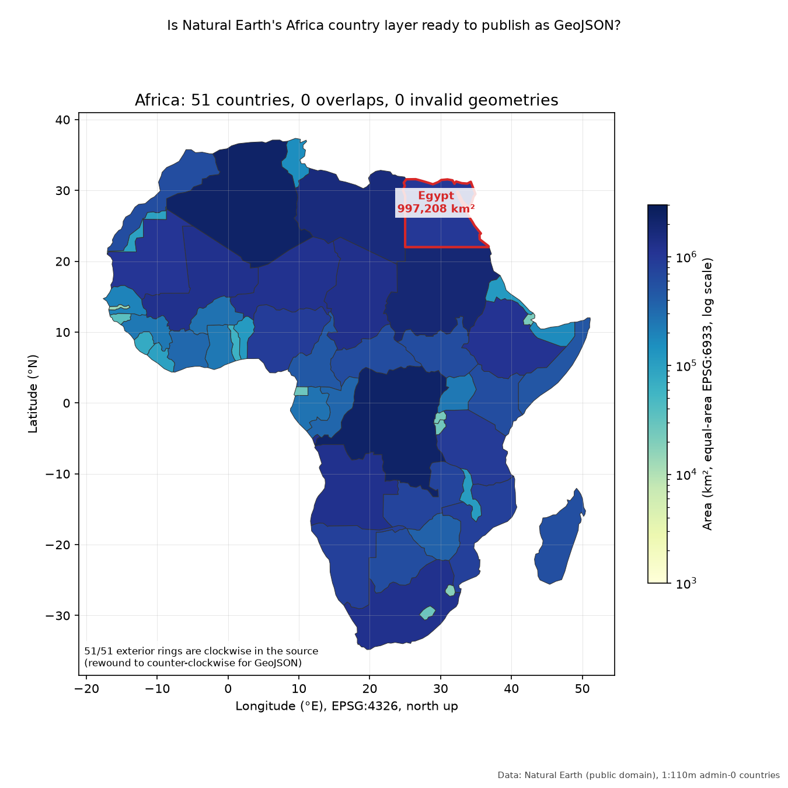

# Is Natural Earth's Africa country layer ready to publish as GeoJSON?

**Question:** do the 51 African country polygons in Natural Earth's 1:110m layer pass GeoQA's geometry and topology checks, and are they in the shape RFC 7946 GeoJSON expects (Egypt is highlighted as a worked example)?



## Data

- **Source:** Natural Earth, 1:110m Cultural Vectors, Admin 0 – Countries: <https://www.naturalearthdata.com/downloads/110m-cultural-vectors/110m-admin-0-countries/>
- **License:** public domain (<https://www.naturalearthdata.com/about/terms-of-use/>). No attribution is required; it is given anyway.
- **Date fetched:** 2026-11-13. The layer is the `naturalearth_lowres` file that ships with GeoPandas 0.14.4. Rows with `continent == "Africa"` (51 features) were kept, along with the `name`, `iso_a3` and `pop_est` columns. Coordinates were copied unchanged into `data/africa_countries_ne110m.geojson` (about 94 KB, EPSG:4326, lon/lat).

## Method

`make_showcase.py` calls this repository's code on that file:

- `geoqa.profile(gdf)` for the overall quality score.
- `GeometryChecker(gdf).check_all()` for validity, empty and duplicate geometries and vertex counts.
- `TopologyChecker(gdf).check_all()` for overlaps between countries, slivers, exterior ring direction and coordinate precision.

CRS and units: input and checks are in EPSG:4326 (lon/lat degrees). Areas are computed after reprojecting to EPSG:6933 (WGS 84 equal-area, metres) and shown in km², because areas in degrees are not meaningful. For `map.geojson` the exterior rings are rewound counter-clockwise and holes clockwise (RFC 7946), and coordinates are rounded to 6 decimals (about 0.1 m).

## Results

From the real output (`python showcase/make_showcase.py`):

- 51 features (50 Polygon, 1 MultiPolygon), 2,242 vertices: 0 invalid, 0 empty, 0 duplicate, 0 overlapping pairs, 0 slivers. The GeoQA quality score is 100.0.
- All 51 exterior rings run clockwise in the source (the Shapefile convention). RFC 7946 expects counter-clockwise, so the published `map.geojson` rewinds them.
- All 51 features carry more than 8 decimal places in the first sampled coordinates, so the coordinates were rounded to 6 decimals for the web map.
- Egypt: 44 vertices, about 997,208 km² in EPSG:6933. Its box in lon/lat is roughly 25–37°E, 22–32°N.

Limits: this is a coarse 1:110m layer, and these checks do not say anything about whether the borders are correct on the ground.

## Links

- Web map: [index.html](index.html) (Leaflet; open it through a web server, e.g. `python -m http.server` from this folder, so the page can fetch the GeoJSON)
- Notebook: [showcase.ipynb](showcase.ipynb)
- GeoJSON result: [map.geojson](map.geojson)

## Rebuild

From the repository root, offline:

```bash
python showcase/make_showcase.py
```

`tests/test_showcase.py` rebuilds into a temporary folder and checks that `map.geojson` matches the committed file. The notebook is run from the `showcase/` folder.

Map tiles in `index.html` are © OpenStreetMap contributors.
